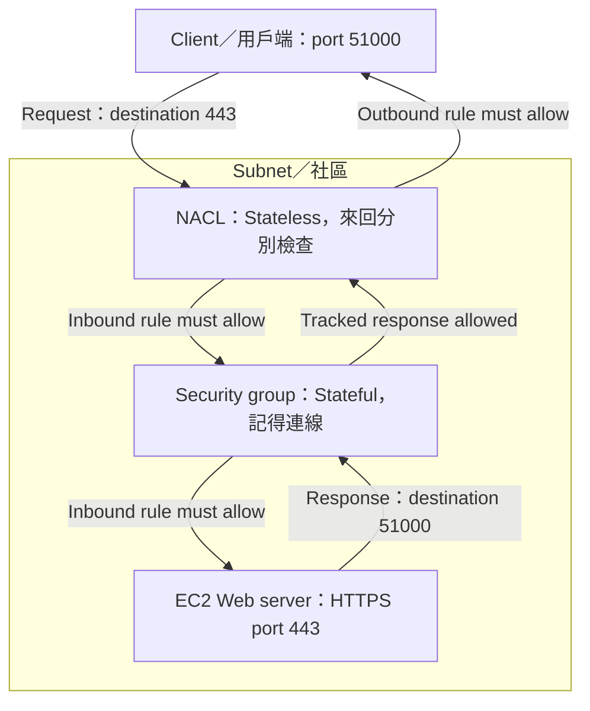
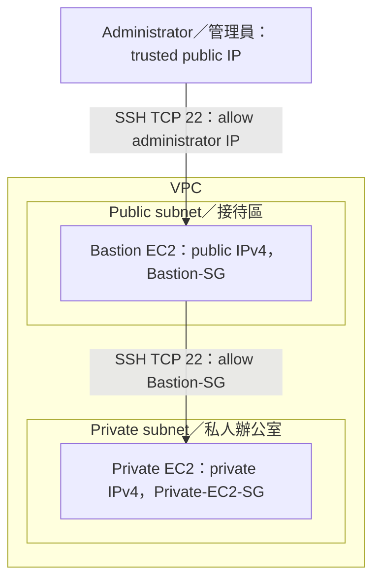
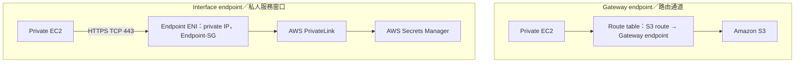

# Module 07 — Creating a Networking Environment
AWS SAA-C03 | 中英雙語考前筆記 | 2026-10-23

> 學習方式：三年級比喻 → 技術說明 → Exam keywords → 排除方法 → 一次一題。適合列印複習。
> Source: AWS Academy Cloud Architecting v3, Module 7 Student Guide (2024), supplied as a 3-minute-10-second screen recording of a 73-page guide. The file opened successfully; readable sampled frames established the title and key topics. Rapid scrolling meant not every page or paragraph could be read. These notes document the actual tutoring session plus explicitly identified official-documentation updates, not a claim of exhaustive page-by-page review.
> Practice completed; no AWS resources were created, and no hands-on lab was executed or verified in this session. 練習完成不代表實作 Lab 完成。
> Requested charts are preserved below as Mermaid diagrams. GitHub is the established destination; no GitLab upload is claimed.

## 0. Learning Results / 學習成果

| Category / 類別 | Correct / Total | Result |
|---|---:|---|
| Original scored questions / 原始計分題 | 12/14 | 85.7% |
| Scored targeted retests / 計分重測 | 2/4 | 50% |
| **Cumulative guided practice / 累計引導練習** | **14/18** | **77.8%** |

- This is guided practice with teaching, hints, diagrams, and repeated concepts, not an independent mock examination or a prediction of passing.
- Q1 was unanswered. Q6's initial wording caused a misunderstanding and was voided. The repeated Q6 disclosed the previously explained answer and was an unscored confirmation.
- Q12, Q15, and Q17 became unscored demonstrations after diagrams revealed their answers. Q15 was later answered B; Q17 was answered A, then the learner correctly identified S3/DynamoDB in an unscored check. Those responses do not change the score.
- Original errors: Q2 (overlap), Q3 (usable addresses).
- Scored retest errors: Q5 (outside VPC), Q22 (NAT vs. PrivateLink).
- Q4 correctly retested usable addresses. Q23 correctly retested inside-VPC AND non-overlap requirements.
- Endpoint selection remains a review priority. Correct unscored checks do not establish independent mastery.
- Checkpoints covered: VPC/CIDR/subnets; routing/IGW/NAT; SG/NACL/bastion; VPC endpoints; Flow Logs and architecture review.
- Time estimates were planning estimates, not measured study duration.
- The recording also showed Gateway Load Balancer endpoint material. It was not taught or tested as a standalone concept in this session; a short unscored reference is included below. No claim is made that every guide detail was covered.

## 1. VPC, AZs, and Subnets / 網路範圍

**Third-grade analogy / 三年級比喻:** Region 像城市，AZ 像分開的園區，VPC 像私人校園。Subnet 像教室，只能在一個園區內，不能一半在這個 AZ、一半在另一個 AZ。

| Component | Scope / 範圍 |
|---|---|
| VPC | Regional; can span multiple AZs within one Region |
| Subnet | Belongs to one VPC and exactly one AZ |
| EC2 instance | Placed in a subnet, therefore in that subnet's AZ |

**Architecture reasoning:** Two subnets in the same AZ do not protect against that AZ failing. Spread application instances across AZs and also provide traffic distribution, healthy capacity, and resilient dependencies.

**Exam keywords:** Regional resource; single AZ; survive an AZ failure.
**Elimination:** Check actual AZ placement, not merely the number of subnets.

## 2. CIDR and Address Ranges / 位址範圍

**Third-grade analogy:** IP address 像「學校.教室.座位」的地址。每一段只能是 0–255。Subnet 分到的座號要在學校總範圍內，而且不能與另一班重複。

IPv4 has 32 bits: four parts (octets), each 8 bits. A /16 fixes the first 16 bits, which aligns with the first two octets.

### All combinations in 10.0.0.0/16 / 所有組合

The first two parts stay fixed at **10.0**. The last two parts independently range from 0 to 255.

| Third part | Full fourth-part range |
|---|---|
| 0 | 10.0.0.0–10.0.0.255 |
| 1 | 10.0.1.0–10.0.1.255 |
| 2 | 10.0.2.0–10.0.2.255 |
| … | Every group in between / 中間每組都包含 |
| 255 | 10.0.255.0–10.0.255.255 |

- After 10.0.0.255 comes **10.0.1.0**, not 10.0.0.256.
- Total: 256 × 256 = **65,536 addresses**.
- 10.0.4.150 is inside this /16; 10.1.4.150 is outside it.
- This “first two octets fixed” shortcut applies to /16. Other prefixes require interpreting the relevant bits; do not apply the shortcut to every prefix.

### Two requirements for a new subnet / 兩個必要條件

1. **Inside the VPC address range / 完全在 VPC 範圍內。**
2. **No overlap with another subnet / 不與現有 Subnet 重疊。**

Different AZs do not permit overlapping subnet CIDRs in the same VPC.

**Overlap analogy:** A 班已占用 0–255 號座位，再分配 128–255 給 B 班仍是重複。較小範圍也可能重疊。

Example: VPC 10.0.0.0/16, existing subnet 10.0.1.0/24.

| Candidate | Full range | Decision |
|---|---|---|
| 10.0.1.128/25 | 10.0.1.128–10.0.1.255 | Overlaps existing subnet |
| 10.1.2.0/24 | 10.1.2.0–10.1.2.255 | Outside VPC |
| **10.0.2.0/24** | **10.0.2.0–10.0.2.255** | **Inside and no overlap** |
| 10.0.0.0/23 | 10.0.0.0–10.0.1.255 | Contains existing range; overlaps |

**Exam approach:** Compare complete ranges. A different starting IP does not guarantee no overlap. Explicitly read “does NOT overlap.”

### Usable IPv4 addresses / 可用位址

**Third-grade analogy:** 教室有一些座位保留給學校，不能分給學生。找最小教室時，要看扣除保留座位後是否夠用。

For the standard AWS-provided IPv4 subnet model used in these questions:
- Total addresses = 2^(32 − prefix).
- AWS reserves the first four addresses and the last address.
- Usable addresses = total − 5.
- Special configurations such as BYOIP have exceptions; this quiz did not use them.

| Prefix | Total | Usable |
|---|---:|---:|
| /25 | 128 | 123 |
| /26 | 64 | 59 |
| /27 | 32 | 27 |
| /28 | 16 | 11 |

Larger prefix number → smaller address block. Each one-bit prefix increase halves the total, then subtract five.

- Need at least 50 usable → /26: 59 usable; /27 has only 27.
- Need at least 20 usable → /27: 27 usable; /28 has only 11.
- “Smallest” means smallest adequate block, not smallest prefix number.

## 3. Route Tables, IGW, and NAT / 流量路徑

### Route selection / 路由選擇

**Third-grade analogy:** Route table 像路口指示牌：「去這個地方，走這個出口。」

| Field | Meaning |
|---|---|
| Destination | Address range the packet is going to |
| Target | Next routing target |

Example routes:
- 10.20.0.0/16 → local.
- 0.0.0.0/0 → Internet Gateway.

A packet to 10.20.6.25 matches both, but **/16 wins over /0** through longest prefix match. 0.0.0.0/0 is the IPv4 default route.

**Exam keywords:** Destination; target; longest prefix match; default route.
**Trap:** More specific route first is a routing principle, not NACL rule-order logic.

### Public subnets and Internet Gateway / 公有子網路

**Third-grade analogy:** 社區要有指向外面大門的路標，住戶也需要可對外使用的地址。

A public subnet has a direct route to an IGW. For direct EC2 IPv4 internet access, also check:
1. A public IPv4 or Elastic IP associated with the instance's private IPv4.
2. Correct route and IGW attachment.
3. Security groups, NACLs, and host/application configuration.

The IGW performs the private/public IPv4 mapping for public-addressed instances. A public subnet alone does not give every EC2 internet access. An additional private IP or a larger subnet does not solve missing public addressing.

### Public zonal NAT Gateway / 私有伺服器對外連線

**Third-grade analogy:** 住戶請管理員代買東西。管理員出去取貨再送回來；外人不能藉此自行進入住戶家。

For the traditional **zonal public NAT** architecture taught in the 2024 guide:
- Private subnet default route → NAT Gateway.
- Public NAT Gateway is placed in a public subnet and has an Elastic IP.
- NAT subnet default route → IGW.
- Private EC2 initiates outbound connections and receives replies; unsolicited internet-initiated connections are not provided by this NAT path.

**Troubleshooting analogy:** 住戶 → 管理員、管理員 → 大門，兩段路都必須通。

**Exam keywords:** Private IPv4 only; download updates; outbound internet; no unsolicited inbound access.
**Elimination:** Inbound SG rules do not create outbound routing. The local route is not an internet exit.

### Availability and current-spec correction / 高可用與現行規格

Q21 assumed NAT Gateways deployed in individual AZs. For that **zonal** architecture, each AZ using a local-AZ NAT Gateway avoids dependence on the other AZ's NAT and can reduce cross-AZ transfer.

**Current official-documentation update:** AWS also provides **Regional NAT Gateway** availability mode, which automatically expands across AZs based on workload presence. It is a VPC-level resource with its own route table; it does not require a public subnet to host it. Thus, “one NAT in each AZ” is not the only current architecture. The public-subnet/EIP/manual per-AZ examples above must not be memorized as universal to every NAT mode.

This correction was found during documentation, not tested in the guided questions. It does not change Q21's best answer among its supplied choices. Check availability mode, current regional support, and pricing when planning a real deployment.

## 4. Security Groups and Network ACLs / 兩層網路控制

**Third-grade analogy:** SG 像記得訪客的教室警衛；NACL 像不記得連線的社區大門警衛，每個方向都重新檢查。

| Feature | Security group | Network ACL |
|---|---|---|
| Scope | Associated ENIs, e.g. EC2 network interface | Subnet boundary |
| State | Stateful | Stateless |
| Rules | Allow only | Allow and Deny |
| Evaluation | All applicable allow rules | Lowest rule number first; stop at first match |
| Response traffic | Automatically allowed for permitted tracked connections | Must be allowed in the reverse direction too |

For a newly created non-default SG, no inbound rules means no newly permitted inbound connections; default outbound rules allow outbound traffic until changed. Distinguish the VPC default SG's self-reference behavior. A default NACL and a new custom NACL also have different initial rules.

### Chart 1 — Request and response / 請求與回應

**Phone analogy:** 從 51000 號房打到商店 443 號櫃台，商店回電要打回 51000 號房。

| Direction | Source port | Destination port |
|---|---:|---:|
| Client → EC2 | 51000 | 443 |
| EC2 → Client | 443 | 51000 |

Ephemeral-port ranges depend on the client/system and architecture. 51000 was the specific example, not the single port to use for every deployment.

### NACL rule order / 編號優先

**Analogy:** 警衛從最小編號開始讀，第一條符合就執行，不再往下看。

| Rule | Traffic | Source | Action |
|---|---|---|---|
| 100 | TCP 443 | 203.0.113.10/32 | Deny |
| 200 | TCP 443 | 0.0.0.0/0 | Allow |
| * | All | Anywhere | Deny |

203.0.113.10 → TCP 443 matches Rule 100 and is denied. /32 identifies a single IPv4 address. There is no generic “Allow always overrides Deny” rule here.

### SG references / 以群組辨認應用層

**Analogy:** 資料室只讓持有老師證的人進入，新老師拿到證件即可，不必逐次改姓名清單。

For App-SG → DB-SG:
- DB-SG inbound TCP 3306, source **App-SG**.
- Supports changing EC2 membership in Auto Scaling without maintaining each current IP.
- In this example, traffic comes from the private IPs of ENIs associated with App-SG.
- Referencing a group does not copy its rules or create routes.
- Allowing the entire VPC is broader than allowing only application resources.

**Exam approach:** Identify the receiver first; configure its inbound permission for the intended source and port.

## 5. Bastion Host / 跳板主機

**Third-grade analogy:** 先到接待室驗證，再進入私人辦公室。接待室不是所有資料流量的通用出口。

### Chart 2 — Two SSH connections / 兩段 SSH

| Receiver | Inbound SSH source |
|---|---|
| Bastion-SG | Administrator's trusted public IP, e.g. /32 |
| Private-EC2-SG | Bastion-SG |

The second connection uses bastion private IP → private EC2 private IP. The diagram omits IGW and route tables to focus on access rules; the public access path still needs them.

**Exam traps:** Administrator public IP applies to the first hop. NAT Gateway does not serve as an SSH jump server. Do not open SSH to 0.0.0.0/0 as the default management design.

## 6. VPC Endpoints / 私人服務通道

**Third-grade analogy:** Gateway endpoint 像通往指定服務的路牌；Interface endpoint 像社區內有私人地址與警衛的服務窗口。

| Feature | Gateway endpoint | Interface endpoint |
|---|---|---|
| Mechanism | Service prefix-list routes in selected route tables | Private IPs on endpoint ENIs in selected subnets |
| Services | S3 and DynamoDB | Many supported AWS/other PrivateLink services |
| Uses AWS PrivateLink | No | Yes |
| Endpoint SG | No attached endpoint SG | Yes |
| NAT/IGW needed for this path | No | No |

**Important:** S3 and DynamoDB support both gateway and interface endpoints in current AWS documentation. “Gateway supports only these two services” does not mean those services can only use gateway endpoints.

### Chart 3 — Gateway vs. Interface / 兩種端點

### Selection and troubleshooting / 選擇與排錯

- Private EC2 → same-Region S3 without NAT/IGW → S3 Gateway endpoint is a suitable choice.
- Private EC2 → Secrets Manager or SQS using PrivateLink → **Interface endpoint**.
- Endpoint-SG inbound TCP 443, source App-SG, for the HTTPS examples.
- Check endpoint DNS/private DNS settings, routes, NACLs, EC2 outbound rules, and endpoint inbound rules.
- Separately check IAM, resource policies, and endpoint policy where supported. Network access is not authorization.
- An IAM policy cannot make an S3 endpoint carry SQS traffic.
- S3 buckets do not receive Elastic IPs.
- A NAT path and a PrivateLink service path are different. Read the exact requirement rather than equating “private EC2” with “private endpoint.”
- Gateway endpoints have no additional endpoint charge; interface endpoints can incur hourly/data-processing charges. Check current regional pricing rather than assuming all endpoints are free.

### Guide topic not separately tested / 未獨立測驗的教材主題

Gateway Load Balancer endpoints are a separate endpoint type used to steer traffic to supported virtual network appliances through Gateway Load Balancer. They are not the S3/DynamoDB gateway endpoints above. This session did not include a scored GWLB scenario.

## 7. VPC Flow Logs / 網路流量紀錄

**Third-grade analogy:** 警衛出入簿記錄誰到哪裡、走哪個門、是否放行；不拆開包裹查看內容。

Flow Logs capture IP-traffic metadata associated with VPC network interfaces. Configure at VPC, subnet, or ENI scope. Destinations include CloudWatch Logs, S3, or supported Data Firehose delivery.

Typical fields:
- Source/destination addresses and ports.
- Protocol, packet count, byte count.
- ACCEPT/REJECT and log status.

| Need | Tool direction |
|---|---|
| IPs/ports and ACCEPT/REJECT | VPC Flow Logs |
| Who changed an SG through an AWS API | CloudTrail |
| Copy packets for deeper analysis | VPC Traffic Mirroring, subject to support |
| CPU utilization | CloudWatch CPU metrics |

**ACCEPT analogy:** 客人能進餐廳，不代表廚師有上班。

ACCEPT does not prove successful HTTP response, application health, listening service, or the complete return path. Flow Logs do not expose the HTTPS request body and are not a universal packet capture.

**Exam keywords:** Traffic metadata; accepted/rejected; network troubleshooting.
**Elimination:** Choose evidence appropriate to the question. Do not infer application success from network permission alone.

## 8. Architecture Decisions / 整體架構與考試判斷

**Third-grade analogy:** 蓋學校時，同時考慮教室座位、道路、門鎖、備用出口與費用，不是只裝一扇大門。

| Principle | Networking choice |
|---|---|
| Reliability | Multiple AZs, adequate failover capacity, resilient outbound dependencies |
| Security | Least privilege, SG references, restricted management entry, suitable private endpoints |
| Performance | Plan sufficient address capacity; avoid unnecessary traffic detours |
| Cost optimization | Assess NAT, endpoint, public IPv4, transfer and logging costs; avoid idle resources |
| Operational excellence | Document routes and rules; collect appropriate traffic evidence |

**30-second decision sequence:**
1. Need a new subnet? Inside VPC AND no overlap.
2. Need address capacity? Calculate total, subtract reserved addresses, choose smallest adequate block.
3. Packet destination? Longest prefix match in route table.
4. Direct IPv4 internet? IGW route + public addressing + permissions.
5. Private IPv4 outbound internet? Suitable NAT architecture and full route path.
6. SG return traffic? Stateful.
7. NACL return traffic? Separate reverse-direction rule; first matching numbered rule wins.
8. App-only DB access? Reference App-SG.
9. Private service access? Check service-specific endpoint support, DNS, and policies.
10. Traffic metadata or API audit? Flow Logs vs. CloudTrail.
11. ACCEPT but timeout? Continue checking application and return path.

## 9. Wrong-Answer Review / 錯答與重測

| Question | Given → correct | Correction | Later evidence |
|---|---|---|---|
| Q2 | A → C | A smaller range inside an existing subnet still overlaps | Unscored small checks correct; Q5 then missed VPC boundary; Q23 finally correct |
| Q3 | C → B | /27 has 27 usable, not enough for 50; /26 has 59 | Q4 scored retest correct |
| Q5, retest | D → B | Non-overlap is insufficient if outside the VPC | Q6 initial item voided for wording; Q23 scored retest correct |
| Q22, retest | C → D | NAT does not establish the required SQS PrivateLink path | No later scored endpoint retest; keep as priority |

Additional unscored observation: Q17 response A confused Gateway and Interface endpoints. The follow-up two-choice identification of S3/DynamoDB was correct, but Q22 showed the distinction still needs reinforcement.

Avoid treating the voided Q6 answer as a learner error. The learner interpreted “both requirements” as asking for overlap; the question should explicitly state “inside the VPC AND does NOT overlap.”

Recommended future review, without extending this completed session: one unseen endpoint selection scenario and one CIDR problem without displayed ranges.

## 10. Complete Answer Log / 完整作答紀錄

| Q | Topic | Given | Correct | Treatment |
|---|---|---|---|---|
| 1 | AZ placement | — | B | Unanswered, excluded |
| 2 | New subnet CIDR | A | C | Original, missed |
| 3 | At least 50 usable IPv4 | C | B | Original, missed |
| 4 | At least 20 usable IPv4 | D | D | Retest, correct |
| 5 | Inside VPC and no overlap | D | B | Retest, missed |
| 6 initial | CIDR, ambiguous wording | A | C | Voided; excluded |
| 6 repeated | Same item after disclosure | C | C | Unscored confirmation |
| 7 | Longest prefix match | B | B | Original, correct |
| 8 | Missing public IPv4 | C | C | Original, correct |
| 9 | Private outbound via NAT | A | A | Original, correct |
| 10 | Missing NAT-subnet IGW route | B | B | Original, correct |
| 11 | Stateful response traffic | C | C | Original, correct |
| 12 | NACL return destination port | — | B | Diagram demonstration, excluded |
| 13 | NACL first matching rule | B | B | Original, correct |
| 14 | DB-SG source App-SG | D | D | Original, correct |
| 15 | Private SSH source Bastion-SG | B | B | Diagram demonstration, excluded |
| 16 | S3 Gateway endpoint | A | A | Original, correct |
| 17 | Secrets Manager Interface endpoint | A | C | Diagram demonstration, excluded |
| 18 | Endpoint-SG inbound HTTPS | C | C | Original, correct |
| 19 | VPC Flow Logs selection | B | B | Original, correct |
| 20 | Meaning of ACCEPT | C | C | Original, correct |
| 21 | Per-AZ zonal NAT resilience | A | A | Original, correct |
| 22 | SQS PrivateLink | C | D | Retest, missed |
| 23 | Explicit inside AND no-overlap | B | B | Retest, correct |
| **Scored total** | **Guided practice** | | | **14/18 = 77.8%** |

Short yes/no, arithmetic, and two-choice understanding checks were unscored.

## 11. Personal AWS Rebuild — Completion Checkpoint

**Worth rebuilding?** Yes, a focused non-production networking exercise would reinforce the missed endpoint distinctions and help turn diagrams into actual routes/rules. Plan first; no AWS work was performed in this session.

**Learning objectives / 目標:**
1. Explain why a private instance can or cannot reach a destination.
2. Build a non-overlapping subnet plan with enough IPs.
3. Compare SG statefulness with NACL direction-specific rules.
4. Compare S3 Gateway and Secrets Manager/SQS Interface endpoints.
5. Read a Flow Log record without overclaiming what ACCEPT proves.

**LFM example / 非正式環境例子:** A small test application reads fictitious memory-entry files from a private S3 bucket, obtains a dummy credential from Secrets Manager, and sends a test message to SQS. Use invented data and separate test resources; production LFM changes are outside this exercise.

**Proposed stages, not execution authorization:**
- Draw the address plan and traffic paths.
- Start with one small test environment; add a second AZ only for a defined resilience objective.
- Compare S3 endpoint routing with an interface endpoint's private DNS, ENI, and SG.
- Optionally enable short-lived Flow Logs and intentionally test one carefully bounded blocked connection.
- Compare bastion management with supported Systems Manager access in a future exercise; validate its own prerequisites before choosing.

**Potential costs / 可能費用:** EC2, EBS, public IPv4/EIPs, NAT Gateways and processing, interface endpoint hours/data, Secrets Manager, SQS/S3 requests and storage, logs ingestion/storage, data transfer, and any retained snapshots. Regional NAT billing is mode/AZ-dependent; verify pricing before deployment. Gateway endpoints have no additional endpoint charge, but related service usage may still cost money.

**Cleanup / 清理:**
- Terminate test EC2; verify EBS deletion and remove unwanted volumes/snapshots.
- Delete test NAT Gateways/interface endpoints; release unneeded EIPs.
- Remove test secrets, queues, buckets/objects and logs according to the exercise's retention decision.
- Remove test ENIs/dependencies before deleting subnets/VPC.
- Recheck billable network resources and log retention.
- No rebuild begins until the user explicitly asks to perform it.

## 12. Official References / 官方參考

Current documentation was checked during final preparation. The 2024 course recording remains the course source; modern features below do not establish exam inclusion or exclusion.

- [Gateway endpoints: S3/DynamoDB, routes, and pricing](https://docs.aws.amazon.com/vpc/latest/privatelink/gateway-endpoints.html)
- [Interface endpoints](https://docs.aws.amazon.com/vpc/latest/privatelink/create-interface-endpoint.html)
- [Regional NAT Gateways: current availability mode](https://docs.aws.amazon.com/vpc/latest/userguide/nat-gateways-regional.html)
- [NAT Gateways](https://docs.aws.amazon.com/vpc/latest/userguide/vpc-nat-gateway.html)
- [NACL concepts and rules](https://docs.aws.amazon.com/vpc/latest/userguide/vpc-network-acls.html)
- [VPC Flow Logs](https://docs.aws.amazon.com/vpc/latest/userguide/flow-logs.html)
- [Subnet sizing and reserved IPv4 addresses](https://docs.aws.amazon.com/vpc/latest/userguide/subnet-sizing.html)
- [Security group rules](https://docs.aws.amazon.com/vpc/latest/userguide/security-group-rules.html)
- [Gateway Load Balancer endpoints](https://docs.aws.amazon.com/vpc/latest/privatelink/gateway-load-balancer-endpoints.html)
- [Amazon VPC pricing](https://aws.amazon.com/vpc/pricing/)

**Next module:** Read the actual Module 8 Student Guide before choosing its title, scope, or checkpoints. Preserve endpoint selection and CIDR as review priorities.
