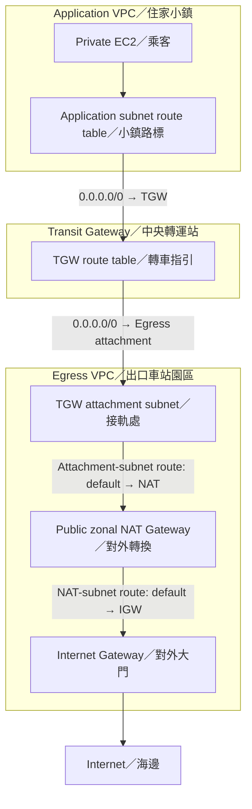
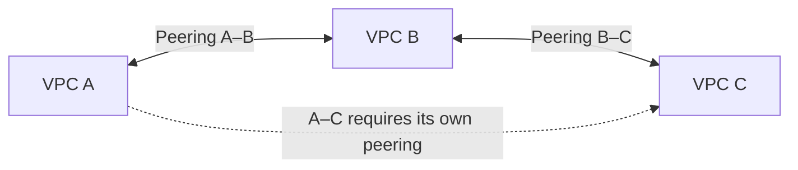
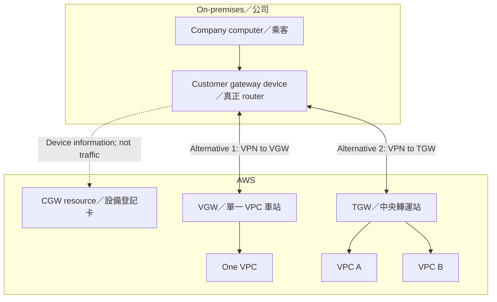

# Module 08 — Connecting Networks
AWS SAA-C03 | 中英雙語考前筆記 | 2026-10-24

> Learning sequence / 學習方式：三年級比喻 → 技術與用途 → Exam keywords 與取捨 → 排除方法 → 一次一題。
> Course source: AWS Academy Cloud Architecting, Module 08 Student Guide, Version 3.0.0, ©2024, supplied as `Student guide - Google Chrome 2026-10-08 15-42-47.mp4`. The recording opened successfully (1920 × 1032; approximately 3 minutes 51 seconds) and showed a 66-page guide. Readable sampled frames across the recording established the title and topics. Blank/loading frames, rapid scrolling, and partially visible pages prevented exhaustive reading of all 66 pages. The objectives page and some VPN/Direct Connect diagram details were incomplete. These notes describe actual tutoring plus identified official-documentation checks, not a complete transcription.
> Tutoring completed; no AWS resources were created, and no hands-on lab was executed or verified. 教學完成不代表實作 Lab 完成。
> GitHub destination: `winniechia/SCC-LMS-AWS-Academy`, `exam-review/module-08/study-notes.md`. The Module 7 format was read first; no existing Module 8 file was found before creation. No PDF was requested or created.

## 0. Learning Results / 學習成果

| Category / 類別 | Correct / Total | Result |
|---|---:|---:|
| Original scored questions / 原始計分題 | 18/18 | 100% |
| Scored targeted reviews / 計分重測 | 0/2 | 0% |
| **Cumulative guided practice / 累計引導練習** | **18/20** | **90%** |

- This was guided practice with teaching immediately before questions, analogies, hints, diagrams, and repeated concepts. It was not an independent mock exam and does not establish independent mastery or predict an exam result.
- Original scored items: Q1–Q3, Q5–Q8, Q10–Q13, Q15–Q20, Q24. Q22 and Q23 are classified here as scored targeted reviews because they revisit the previously explained CGW and endpoint distinctions in changed scenarios. This audit clarifies earlier interim labels; the cumulative total remains 18/20.
- Q1 was initially misgraded: the interactive card displayed **A = Transit Gateway**, while the underlying authoring order placed that answer at C. The screenshot confirmed the learner's answer was correct. Record the selected content, not the hidden order. No learner error or remedial retest is attributed to Q1.
- Q3: the learner immediately corrected B to D before grading. Accept D and count once.
- Q4 became an unscored demonstration when the requested diagram revealed the answer.
- Q9: “I don't know” was not a scored answer. The explanation disclosed C; the question became an unscored demonstration.
- Q14 became an unscored demonstration when the requested CGW diagram revealed A. The following “actual office router” response confused resource and device; a later “resource” confirmation was correct. Both checks were unscored.
- Q21 repeated the already disclosed Q4 scenario. It was voided as a scored retest and retained only as an unscored review observation. The learner selected C; D was explained. It does not affect the score.
- The bounded final review ended after Q21–Q24: one voided/unscored repeat, two missed scored targeted reviews, and one correct original scored item. No additional questions were added.
- Remaining priorities: **destination vs. next hop in centralized egress; CGW resource vs. actual device; SQS/Secrets Manager Interface endpoints vs. TGW/NAT/S3 Gateway endpoints**. Do not mark these mastered based on earlier correct answers.
- Time estimates were planning estimates, not measured study duration.

### Checkpoints completed / 已完成範圍

| Checkpoint | Topics / 主題 |
|---|---|
| 1 | Full mesh, hub-and-spoke, TGW, VPC/TGW route tables, centralized egress |
| 2 | VPC peering, non-transitivity, non-overlapping CIDRs, return routes |
| 3 | PrivateLink, Interface endpoints, endpoint SGs, NLB endpoint services |
| 4 | Site-to-Site VPN, CGW resource/device, VGW/TGW, two tunnels, BGP, accelerated VPN |
| 5 | Direct Connect, encryption, independent backup paths, VIF selection |
| 6 | Reliability/security/cost trade-offs and four-item bounded final review |

## 1. Full Mesh vs. Hub-and-Spoke / 逐對連接與中央樞紐

**Third-grade analogy / 三年級比喻:** 四間學校都要互寄包裹。Full mesh 為每兩間蓋一條直達道路；hub-and-spoke 讓每間學校接到中央轉運站。

| Pattern | Four VPCs | Twenty VPCs | Trade-off |
|---|---:|---:|---|
| Full mesh | 6 pairwise connections | 190 pairwise connections | Direct paths, but increasing connection/routing management |
| Hub-and-spoke | 4 hub attachments | 20 hub attachments | Central management; assess hub/attachment and processing costs |

For a full mesh, connection count = n(n − 1)/2. This is topology arithmetic, not an AWS quota.

AWS Transit Gateway (TGW) acts as a network hub connecting VPCs and hybrid networks. Attachments connect networks to the hub; routes determine where packets go. An attachment alone does not prove application connectivity.

**Exam keywords:** many VPCs; centralized routing; simplify management; hub-and-spoke.
**Elimination:** First identify the requested scope: general network interconnection, one service, or outbound internet access. A NAT Gateway or S3 endpoint is not a substitute for a multi-VPC transit hub.

## 2. Destination vs. Next Hop / 最終目的地與下一站

**The train analogy that helped / 火車比喻:** EC2 的封包是一位乘客。Application VPC 是住家小鎮；TGW 是中央轉運站；Egress VPC 是提供對外交通的出口車站園區；Internet 是外面的海邊。

| Concept | Train meaning / 火車意思 | AWS meaning |
|---|---|---|
| Destination | 最終要去海邊 | Packet's destination IP/CIDR |
| Target / next hop | 下一段搭往哪裡 | Next routing target |
| TGW attachment | 通往某個小鎮/園區的接軌線 | Connection between TGW and the attached network |
| Route table | 站員的轉車指引表 | Destination-to-target routing entries |

**A passenger going to the seaside keeps that destination while passing through the exit station. 封包經過 Egress VPC，不會因此把目的地改成 Egress VPC CIDR。**

### VPC-to-VPC example / 兩層路由表

VPC A = `10.1.0.0/16`; VPC B = `10.2.0.0/16`.

| Route table | Destination | Target |
|---|---|---|
| A application subnet | `10.2.0.0/16` | TGW |
| TGW table used by traffic arriving from A | `10.2.0.0/16` | B attachment |
| B application subnet, for return | `10.1.0.0/16` | TGW |
| TGW table used by traffic arriving from B | `10.1.0.0/16` | A attachment |

TGW uses the route table associated with the incoming attachment. Its route destination selects the outgoing attachment. VPC route tables and TGW route tables are separate. Required subnet routes and security rules must allow the full path.

**Exam approach:** Identify the table being configured; identify the destination; select that table's next hop. Do not use the packet's source network as the route destination just because traffic originated there.

## 3. Centralized Egress / 集中對外出口

**Egress = outbound traffic / 出站流量。Ingress = inbound traffic / 入站流量。** Direction is relative to the boundary being described.

**Third-grade analogy:** 多個小鎮共用一個出口車站，不必每個小鎮都設一整套對外設施。Egress VPC 是按用途取的名稱，不是一種特殊 VPC 或另一個 AWS 服務。

### Requested diagram — outbound path and boundaries / 對外路徑圖

The diagram is an educational **traditional public zonal NAT** example, not a deployable template. It omits AZ duplication, EIPs, security rules, DNS, and detailed return routing. TGW performs routing; it does not itself provide NAT or an internet gateway.

| Routing decision | Entry / Meaning |
|---|---|
| Application subnet sends outbound traffic to hub | `0.0.0.0/0 → TGW` |
| TGW sends that traffic to shared exit | `0.0.0.0/0 → Egress VPC attachment` |
| Egress attachment subnet sends to NAT | Default route → NAT Gateway |
| NAT public subnet sends to internet | Default route → IGW |
| Return to application network | Egress route for application CIDR → TGW; TGW route → application attachment |

`0.0.0.0/0` matches all IPv4 destinations; a more specific matching route wins. In this scenario, it handles internet destinations without a more specific route.

**Why Q21 C was wrong:** `Application VPC CIDR → Egress attachment` matches packets going **to the application network**, not packets going to external websites. Likewise, `Egress VPC CIDR → Egress attachment` only matches destinations inside that CIDR.

**Unscored checks:** learner correctly identified TGW as the hub, Egress VPC as still on the journey, and the seaside as the final destination. Later Q21 showed the mapping back to routing syntax still needed reinforcement.

**Current-spec boundary:** AWS also documents Regional NAT Gateway availability mode with its own route table and automatic AZ expansion. It does not require a public subnet to host the NAT. Do not generalize the zonal diagram into “all NATs must be in a public subnet” or “one NAT per AZ is always required.” Regional mode was a documentation clarification, not a scored exercise.

**Trade-offs:** Shared policy/inspection and fewer duplicated exit facilities can simplify management; assess TGW processing, NAT, transfer, capacity, AZ failure dependencies, and return routing. Centralization is not automatically cheapest or most resilient.

## 4. VPC Peering / 兩個 VPC 的直達連線

**Third-grade analogy:** Peering 像兩個小鎮之間的直達鐵路。A–B 與 B–C 各有鐵路，不表示可以把 B 當中央轉運站。

### Non-transitive peering / 不能借道轉送

VPC peering is non-transitive. For direct A–C peering communication, create A–C peering and the required routes/security rules. Security rules cannot enable unsupported transit, and peering does not supply automatic BGP-style route propagation.

### Non-overlapping CIDRs / 位址不能重疊

**Analogy:** 兩個小鎮都用相同地址，包裹可能分不清要去哪裡。Peering 要求位址範圍不重疊。

| VPC | CIDR | Full range |
|---|---|---|
| A | `10.20.0.0/16` | `10.20.0.0–10.20.255.255` |
| B | `10.20.8.0/24` | `10.20.8.0–10.20.8.255` |

B is wholly inside A's range, so they overlap. Different prefix lengths, accounts, or Regions do not remove this restriction. Peering can connect different accounts/Regions when its requirements are met. If VPCs have multiple CIDRs, an overlap cannot be bypassed merely by intending to use other non-overlapping blocks.

### Return routes / 回程也要指路

**Analogy:** 去程找到車，回程也需要指引。Active peering 不會自動替兩端填好路由表。

| Table | Destination | Target |
|---|---|---|
| A application subnet | B CIDR | `pcx-ab` |
| B database subnet | A CIDR | `pcx-ab` |

One peering connection can carry traffic both ways; do not create a separate reverse peering. SG statefulness does not create missing routes. Check NACLs and application/IAM requirements separately where applicable.

**Exam keywords:** non-transitive; overlapping CIDRs; active but timeout; missing return route.
**Trade-off:** Direct connectivity is straightforward for a small number of networks, but a full mesh becomes harder to manage.
**Elimination:** Compare full address ranges, then follow request and response paths. A visible line in a diagram is not proof of transit support.

## 5. AWS PrivateLink and Interface Endpoints / 特定服務的私人入口

**Third-grade analogy:** 你只想使用另一個小鎮的圖書館，不需要接通整個小鎮的所有道路。Interface endpoint 像自己車站內的專用服務入口；PrivateLink 是背後的私人連線技術。

| Component | Role / 用途 |
|---|---|
| TGW | Central network transit hub / 多網路中央樞紐 |
| VPC peering | Direct network connection between two VPCs / 兩個 VPC 直連 |
| Interface endpoint | Private entrance to a supported service / 特定服務入口 |
| NAT Gateway | Address translation, such as an outbound internet path / 位址轉換 |
| Gateway endpoint | Route-based S3/DynamoDB access; does not use PrivateLink |

For the IPv4 examples, an Interface endpoint has endpoint ENIs with private IPs in selected subnets. It uses PrivateLink. The provider service is not moved into the consumer VPC merely because an endpoint ENI is present.

### Service selection / 先選對服務入口

| Requirement | Suitable endpoint |
|---|---|
| Secrets Manager via PrivateLink | Secrets Manager Interface endpoint |
| SQS via PrivateLink | SQS Interface endpoint |
| S3/DynamoDB gateway-style access | Matching Gateway endpoint |

Gateway endpoints support S3 and DynamoDB; they do not support SQS or Secrets Manager. S3 and DynamoDB also have Interface endpoint options: do not memorize “only Gateway can access them.” An IAM policy cannot make an S3 endpoint carry SQS requests. A TGW attachment alone does not supply a service-specific PrivateLink endpoint.

**SQS correction / 重要錯答:** Q10 was correct, but Q23 selected TGW + S3 Gateway endpoint. Adding a central train station cannot turn an S3 entrance into an SQS entrance. The required component remains the **SQS Interface endpoint**. This distinction is not yet mastered.

### Endpoint security group / 入口警衛

**Analogy:** 專用入口有警衛，只讓持有 App-SG 身分的乘客進入。

| Receiver | Direction | Protocol/port | Source |
|---|---|---|---|
| Endpoint-SG | Inbound | TCP 443 | App-SG |

Direction is from the endpoint's perspective. Also check App-SG outbound rules, NACLs, supported DNS/private DNS settings, and IAM/resource/endpoint policies. Network reachability is not authorization. The normal SQS HTTPS endpoint/private-DNS setup should resolve to the intended endpoint path; follow current service documentation.

### Sharing an application behind an NLB / 跨 VPC 分享服務

Provider: application behind an NLB → endpoint service. Consumer: Interface endpoint → that service. This application-service model can support overlapping consumer/provider CIDRs; it does not provide arbitrary bidirectional network transit. The consumer initiates the service connection; replies still return on that connection.

**Train analogy:** 兩個小鎮地址重複，但乘客只使用對方圖書館的專用入口，不需要把兩套路網直接合併。

**Exam keywords:** specific service; PrivateLink; ENI/private IP; endpoint service; NLB; overlapping CIDRs.
**Trade-offs:** Narrower service exposure, with endpoint hourly/data costs and DNS/security configuration. General network connectivity and service connectivity can coexist in a larger architecture; they are not interchangeable.
**Elimination:** Name the service first. Check endpoint support second. Check the required connectivity technology third. Do not treat “private EC2” as proof of PrivateLink access.

## 6. Site-to-Site VPN / 公司網路到 AWS 的加密連線

**Third-grade analogy:** 公司利用既有公共交通路網運送上鎖包裹。Internet 是公共路網；IPsec 是鎖。這不是新蓋一條專用實體鐵路。

Site-to-Site VPN provides IPsec connectivity between on-premises networks and AWS. Internet-based VPN is a common way to begin using an existing internet connection and compatible device. It depends on that path's performance. A supported VPN can also run over Direct Connect; do not assume all Site-to-Site VPNs must traverse the public internet.

### CGW resource vs. device / 汽車與行照

| Name | What it is | Analogy |
|---|---|---|
| Customer gateway device | Actual physical router or software VPN appliance on the customer side | 真正的汽車／公司車站 |
| Customer Gateway resource | AWS configuration describing the customer device | 行照／設備登記卡 |
| Virtual Private Gateway (VGW) | AWS-side VPN endpoint attached to one VPC | AWS 端單一 VPC 車站 |
| Transit Gateway (TGW) | AWS-side VPN endpoint and hub for multiple networks | AWS 中央轉運站 |

Creating a CGW resource does not install or configure the office router. The real device still needs the VPN configuration, IPsec/tunnel settings, and routing appropriate to the chosen architecture.

### Requested diagram — registration vs. traffic / 登記資料與流量分開

The solid paths show alternative AWS-side gateway choices, not a requirement to deploy both. CGW is a record about the company device; it is not on the packet-forwarding path.

**Learner evidence:** After explanation, “resource” was correctly identified in an unscored check. Q22 later selected Interface endpoint as a way to configure the router. That was incorrect: an endpoint is a service entrance, not a device installer or router configuration tool. Keep this distinction as a review priority.

### Two tunnels / 兩條 tunnel 不等於兩台 router

One VPN connection includes two tunnels. Configure both and the needed routing/failover. A failure of one tunnel need not interrupt the other, but both can fail if they share the only office router and it fails.

**Analogy:** 兩條軌道若都經過同一座橋，橋壞了仍會一起中斷。Tunnel redundancy is not device, ISP, power, or site redundancy.

### Static routing vs. BGP / 手寫清單與動態通報

**BGP = Border Gateway Protocol / 邊界閘道協定。**

| Method | Train analogy | Technical role |
|---|---|---|
| Static routing | 站員手動修改路線清單 | Manually maintained network routes |
| Dynamic routing / BGP | 兩邊站員用共同語言互報可到達的地方 | Routers exchange network reachability information |

BGP exchanges routes; IPsec encrypts data; SGs filter permitted traffic. These are distinct tasks. BGP does not repair failed hardware or eliminate the need for correct route/security configuration. Routing support and configuration depend on the chosen AWS gateway and architecture.

### Accelerated Site-to-Site VPN / 更早進入 AWS 路網

**Analogy:** 先到較近 AWS 入口，較早搭上 AWS 的長途路網，減少長途公共 Internet 路徑的影響。

Accelerated VPN uses Global Accelerator to optimize the path and requires a TGW attachment; VGW does not support it. It remains VPN connectivity, has extra charges, and is not a dedicated DX circuit or a promise of zero latency. Additional operational restrictions must be checked before implementation.

**Exam keywords:** on-premises; IPsec; two tunnels; BGP; customer gateway device; Global Accelerator.
**Elimination:** Separate equipment, AWS registration resources, encryption, route exchange, and failure domains. Do not use an Interface endpoint to configure a VPN router.

## 7. Direct Connect / 專用網路連線

**Third-grade analogy:** Direct Connect 像安排通往 AWS 的專用鐵路。行程通常較一致，但專用鐵路不等於包裹自動上鎖，也不表示鐵軌永遠不壞。

Direct Connect provides dedicated network connectivity rather than using a general internet path. It suits sustained transfer and more consistent network performance; circuit/provider provisioning, costs, and resiliency need planning. It is not always the quickest solution to start within days.

| Requirement | Direction |
|---|---|
| Existing internet, compatible router, encrypted network link quickly | Internet Site-to-Site VPN |
| Dedicated network path and more consistent performance | Direct Connect |
| Encryption over DX | Design encryption separately |
| Independent failure backup | Another suitable independent DX path and/or VPN, based on requirements |

### Encryption / 專用不等於加密

DX does not encrypt transit traffic by default. Supported combinations with Site-to-Site VPN provide IPsec encryption over DX. TLS protects relevant application traffic. MACsec is available only on supported connections and protects the appropriate link segment, not automatically every end-to-end segment.

**Q24 correction:** A is correct because the requirement explicitly asks for IPsec **over the primary DX path**. Default DX behavior is insufficient; a second VIF does not automatically enable IPsec; keeping encryption only on the backup does not meet primary-path encryption requirements.

### Independent backup / 不要把兩條線畫在同一座橋上

One DX connection is not automatic high availability. Another VIF or BGP session on the same failed physical circuit does not restore it. An independent internet VPN can be an appropriate lower-cost backup if reduced outage performance is acceptable. Configure route preferences/failover and test capacity; do not claim DX automatically creates a backup VPN.

Multiple DX connections should be evaluated for device, location, carrier/physical-path, and other shared dependencies. Do not generalize the course's simplified path preference examples into unconditional behavior for every routing architecture and prefix.

### Virtual interfaces / 邏輯通道，不是新鐵路

**Analogy:** 一條實體鐵路上可以劃分不同邏輯通道。VIF does not mean an independent physical circuit.

| VIF | Destination / 用途 |
|---|---|
| Private VIF | VPC private-IP access, directly through VGW or through DX gateway with supported associations |
| Public VIF | AWS public service endpoints over DX, e.g. S3; not general internet transit |
| Transit VIF | DX gateway associated with Transit Gateway |

Q20 path: **DX → Transit VIF → DX gateway → TGW → attached VPCs**.

“Public” describes public addressing/service endpoints; it does not mean the DX traffic now travels over the public internet.

**Exam keywords:** dedicated; consistent performance; IPsec over DX; backup; private/public/transit VIF.
**Trade-offs:** Provisioning time and circuit cost versus consistency/capacity; dedicated connectivity versus encryption are separate decisions.
**Elimination:** Match the destination to VIF type, then inspect encryption and shared failure points separately.

## 8. Architecture Reasoning / 整體取捨

**Third-grade analogy:** 設計交通系統，同時檢查路標、車站入口、包裹鎖、備用橋與費用。單一元件不會一次解決所有問題。

| Principle | Question to ask / 判斷問題 |
|---|---|
| Reliability | Do backup paths share the same device, circuit, site, or power? |
| Security | Is the path private? Is data encrypted? Is access authorized? Check each separately. |
| Performance | Does the path meet capacity/latency needs, including during failover? |
| Cost | Can outage performance be reduced? Are endpoints, TGW, VPN, NAT, or DX justified? |
| Operations | Are routes, DNS, device configuration, failover, and cleanup documented and verified? |

**Exam decision sequence / 考題順序:**
1. Identify endpoints: VPC-to-VPC, on-premises-to-AWS, or application-to-service.
2. Identify scope: general network connectivity or a specific service.
3. Identify route destination and next hop; never substitute source CIDR for destination.
4. Check address overlap and transit limitations.
5. Check request/return routes and security separately.
6. If PrivateLink is explicit, select the correct service's Interface endpoint.
7. If VPN equipment is involved, distinguish device from AWS resource.
8. Check encryption separately from dedicated/private connectivity.
9. Test failure domains, backup performance, and cost against exact requirements.

## 9. Wrong-Answer and Support Review / 錯答與需協助觀念

| Item | Learner evidence | Correction | Status |
|---|---|---|---|
| Q1 grading | Displayed A was TGW | Screenshot confirmed correct; assistant order error | Corrected; not a learner weakness |
| Q4/Q21 egress | Needed train explanation; Q21 C selected | Destination is external IP; TGW default route targets Egress attachment | Unscored review need, not a scored error |
| Q9 endpoints | “I don't know”; C disclosed | Secrets Manager via PrivateLink uses Interface endpoint | Unscored demonstration |
| CGW checks | Actual router confused with resource; later “resource” correct | Device = actual router; resource = AWS registration | Unscored checks do not establish mastery |
| **Q22 targeted review** | **D → B** | **Interface endpoint does not configure router; configure actual VPN device** | **Scored error; unresolved** |
| **Q23 targeted review** | **D → C** | **TGW + S3 endpoint is not an SQS PrivateLink path** | **Scored error despite Q10 correct; unresolved** |

Suggested later study, not additional questions in this completed session: redraw the egress table from the destination's perspective; explain resource/device without choices; identify a required service endpoint from a fresh scenario. Preserve the first-attempt responses and do not count a repeated disclosed question as an independent retest.

## 10. Complete Answer Log / 完整作答紀錄

Letters refer to the displayed plain-text question unless an interactive-card order correction is noted. Topic/result take precedence over hidden authoring order.

| Q | Topic | Given | Correct | Treatment |
|---|---|---|---|---|
| 1 | Central hub for 20 VPCs | Displayed A: TGW | TGW, authored C | Original correct; initial grading corrected from screenshot |
| 2 | A subnet route to B via TGW | B | B | Original correct |
| 3 | TGW route to B attachment | B, immediately corrected to D | D | Original correct; count once |
| 4 | Centralized egress default route | No scored response | A | Diagram disclosed answer; unscored demonstration |
| 5 | A subnet route to B database | C | C | Original correct |
| 6 | Non-transitive peering | B | B | Original correct |
| 7 | Overlapping VPC CIDRs | C | C | Original correct |
| 8 | Missing return route over peering | A | A | Original correct |
| 9 | Secrets Manager PrivateLink | “I don't know” | C | Unanswered then disclosed; unscored demonstration |
| 10 | SQS PrivateLink | A | A | Original correct |
| 11 | Endpoint-SG inbound 443 from App-SG | D | D | Original correct |
| 12 | NLB service across overlapping VPCs | B | B | Original correct |
| 13 | Office IPsec connection over existing internet | D | D | Original correct |
| 14 | Meaning of CGW resource | No scored response | A | Diagram disclosed answer; unscored demonstration |
| 15 | Single office router failure | C | C | Original correct |
| 16 | Dynamic VPN routing/BGP | B | B | Original correct; acronym explained before response |
| 17 | Accelerated VPN | D | D | Original correct |
| 18 | Dedicated sustained hybrid connection | A | A | Original correct |
| 19 | Independent lower-cost VPN backup | C | C | Original correct |
| 20 | Transit VIF through DX gateway to TGW | B | B | Original correct; repeated prompt before answer was not another question |
| 21 | Egress default route, repeated Q4 | C | D | Voided as scored retest; unscored review observation |
| 22 | CGW record does not configure actual device | D | B | Scored targeted review, missed |
| 23 | Repair S3-endpoint/TGW proposal for SQS | D | C | Scored targeted review, missed |
| 24 | IPsec over primary DX path | A | A | Original correct, final review |
| **Total** | **Guided practice** | | | **18/20 = 90%** |

### Unscored checks / 不計分口頭確認

- TGW = central train station: correct.
- At Egress VPC, still on the journey: correct.
- Final destination = seaside: correct.
- Interface endpoint = entrance to a specific service: correct.
- CGW resource = actual office router: incorrect; explained with car/registration analogy.
- New AWS registration item = resource: correct after explanation.

No invalid input was scored. Diagrams that disclosed answers turned the relevant unanswered questions into demonstrations. Q21 was excluded because it was a repeated disclosed question, not because its response was correct or incorrect.

## 11. Personal AWS Rebuild — Completion Checkpoint

**Worth rebuilding? / 值得重建嗎？** Yes, selectively. Start with a small, non-production exercise that reinforces paths, service endpoints, and the distinction between connectivity and permissions. DX physical provisioning and full hybrid redundancy are better treated as design work first.

**Learning objectives / 學習目標:**
1. Label destination vs. next hop at every routing decision.
2. Build and verify a peering request/return path with non-overlapping CIDRs.
3. Access SQS using an Interface endpoint, private DNS, appropriate SGs, and IAM.
4. Explain why TGW/NAT/S3 endpoints cannot replace the required SQS PrivateLink component.
5. Identify CGW device/resource and both tunnel/device failure domains on paper before VPN work.

**Non-production LFM example / 虛構 LFM 範例:** A test application submits an invented memory-entry ID to a test SQS queue. Use fictitious content, isolated test resources, and no production LFM credentials or private caregiving data. Add a second test VPC only for the peering objective; do not build a full production-like network merely to rehearse the vocabulary.

### Proposed sequence, not execution / 規劃而非執行

| Stage | Objective | Scope |
|---|---|---|
| 1 | Draw packet destination, next hop, return path, service entrance | Paper/Markdown; no AWS resources |
| 2 | One SQS Interface endpoint exercise with restricted SG/IAM | Small isolated test environment; verify DNS and API result |
| 3 | Two-VPC peering and a deliberately missing return route | Short-lived resources; distinguish network vs application failure |
| 4 | Optional TGW egress/VPN comparison | Plan cost, NAT mode, device configuration and exact learning goals first |
| 5 | DX/VIF/encryption/failure-domain design | Diagram exercise; do not order a physical circuit for this study module |

**Potential costs / 可能費用:** EC2/EBS, public IPv4/EIPs, interface endpoint hours and processing, SQS requests, Secrets Manager if added, TGW attachments/data, VPN connection hours, accelerated VPN/Global Accelerator costs, NAT hours/processing, transfer, logs, and any DX/provider/cross-connect charges if ever provisioned. Check current regional pricing and expected duration before an actual rebuild; no dollar quote was established here.

**Cleanup / 清理:**
- Remove test VPN connections/accelerated resources if created; verify associated billable resources are gone.
- Delete test Interface endpoints and TGW attachments/TGW after dependent routes are removed.
- Delete test NAT Gateways and release unused EIPs; check IPv4 charges.
- Terminate test EC2 and inspect retained EBS volumes/snapshots.
- Delete test peering, queues, secrets, logs, subnets, route tables, SGs, and VPCs in dependency order, according to the exercise's retention decision.
- Verify service deletion status, retained logs/storage, and billable network resources. Do not delete production LFM resources.
- A real DX circuit would require provider-side cancellation as well as AWS cleanup; this module does not authorize ordering one.

**Authorization boundary:** Plan first. No AWS resources were created. Do not start a rebuild until the learner explicitly asks to perform it.

## 12. Source Accuracy and Coverage / 教材年代與範圍

- The course recording is ©2024. Official documentation was checked during the session/final documentation; these checks do not imply every recorded page was readable.
- Readable material confirmed multi-VPC topology, TGW routing activities/centralized egress, VPC peering, PrivateLink/NLB service architecture, Site-to-Site VPN/acceleration, DX/resiliency, and Well-Architected networking principles.
- The recording described a guided VPC peering lab and an online knowledge check. Neither was executed or verified here; this session's generated questions are not a claim of official course knowledge-check completion.
- Fine details of all 66 pages, full VPN/device configuration, measured throughput, failover timing, and actual DX provisioning were not reviewed exhaustively or tested hands-on.
- VPN tunnel throughput depends on current tunnel/gateway options. These notes intentionally do not teach an old single throughput number as a universal cap; exact bandwidth options were not tested.
- NAT examples are explicitly zonal. Regional NAT is a current-documentation clarification, not an independently tested learning objective.
- PrivateLink regional/service support and operational requirements evolve. Do not infer that all PrivateLink access must be same-Region from a same-Region course diagram.
- No service lifecycle or new feature alone establishes what is included or excluded on SAA-C03. Validate current documentation when implementing.

## 13. Official References / 官方參考

Checked official sources supporting the technical distinctions above:

- [TGW concepts, attachments, route tables, association, and pricing](https://docs.aws.amazon.com/vpc/latest/tgw/what-is-transit-gateway.html)
- [VPC attachments and routing](https://docs.aws.amazon.com/vpc/latest/tgw/tgw-vpc-attachments.html)
- [VPC peering: lifecycle, non-transitivity, overlap, and routes](https://docs.aws.amazon.com/vpc/latest/peering/vpc-peering-basics.html)
- [PrivateLink service architecture and overlapping CIDRs](https://docs.aws.amazon.com/whitepapers/latest/building-scalable-secure-multi-vpc-network-infrastructure/aws-privatelink.html)
- [Interface endpoint ENIs, security groups, DNS, and pricing](https://docs.aws.amazon.com/vpc/latest/privatelink/create-interface-endpoint.html)
- [SQS interface endpoints and private DNS](https://docs.aws.amazon.com/AWSSimpleQueueService/latest/SQSDeveloperGuide/sqs-internetwork-traffic-privacy.html)
- [Site-to-Site VPN concepts: CGW resource/device, VGW/TGW, and tunnels](https://docs.aws.amazon.com/vpn/latest/s2svpn/VPC_VPN.html)
- [VPN routing options](https://docs.aws.amazon.com/vpn/latest/s2svpn/VPNRoutingTypes.html)
- [Accelerated VPN requirements](https://docs.aws.amazon.com/vpn/latest/s2svpn/accelerated-vpn.html)
- [Direct Connect virtual interface types](https://docs.aws.amazon.com/directconnect/latest/UserGuide/WorkingWithVirtualInterfaces.html)
- [Direct Connect encryption](https://docs.aws.amazon.com/directconnect/latest/UserGuide/encryption-in-transit.html)
- [MACsec scope](https://docs.aws.amazon.com/directconnect/latest/UserGuide/MACsec.html)
- [Direct Connect connectivity and backup FAQ](https://aws.amazon.com/directconnect/faqs/)
- [Regional NAT Gateway availability mode](https://docs.aws.amazon.com/vpc/latest/userguide/nat-gateways-regional.html)

**Next module / 下一模組:** Read the actual Module 9 material before choosing its title or scope. Carry forward endpoint selection, CGW device/resource, and egress destination/next-hop as review priorities; do not restart completed modules or extend this completed review with extra questions.
